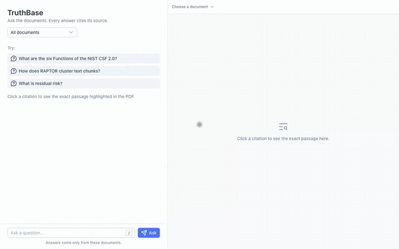
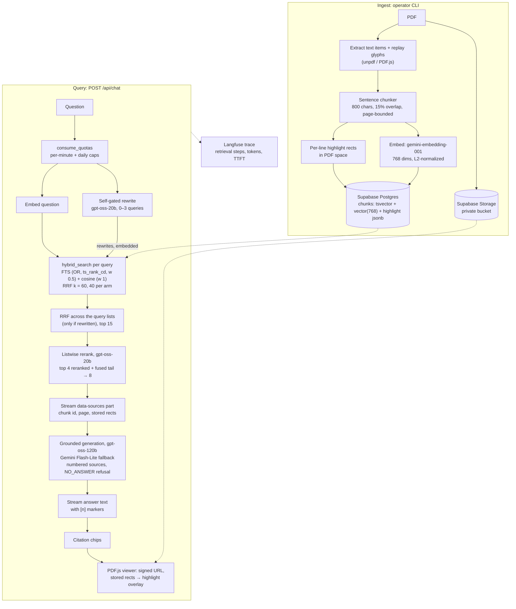

# TruthBase

**Verifiable RAG over PDFs: answers cite their sources inline, and clicking a citation scrolls the PDF to the exact page and highlights the exact supporting passage.** Built on Nuxt 4 and Supabase (pgvector and Postgres full-text search), measured against a 50-question golden set.

**Live demo: [truthbase-brown.vercel.app](https://truthbase-brown.vercel.app)**. No login. Four public PDFs (NIST CSF 2.0, NIST AI RMF 1.0, the RAPTOR and Self-RAG papers). Runs on free tiers for 0 EUR/month.

[](./docs/media/demo.mp4)

*Click the GIF for the full video (MP4).*

## Headline numbers

The highlight, retrieval and answer numbers below are on [`docs/golden/golden.json`](./docs/golden/golden.json) (50 questions: 45 answerable, 5 unanswerable), recorded in the files linked. At n = 45, one question moves a metric by 2.2 points.

| What | Result | Measured on | Source |
|---|---|---|---|
| **Highlight placement** | 176/180 checks pass (60 golden spans × zoom 50/100/200%); placement error ≤ 0.03 px; the 4 misses are listed under [Limitations](#limitations-and-roadmap) | Real viewer in headless Chromium against the hosted corpus (`pnpm check:viewer`) | [ROADMAP Phase 5](./ROADMAP.md) |
| **Highlight edges vs an independent PDF engine** | within ±0.05 pt of MuPDF on every golden span (spike max: 0.001 pt) | Vitest, `ingest-glyphs.test.ts` | [ADR-0004](./docs/adr/0004-extraction-and-highlights.md) |
| **Hybrid retrieval recall@8** | **87%** (dense-only 76%) | Hybrid v2, 564 chunks, gated in CI | [ADR-0006](./docs/adr/0006-hybrid-search.md), [retrieval-baseline.json](./docs/evals/retrieval-baseline.json) |
| **Reranking: MRR / nDCG@5** | 0.515 → **0.735** / 0.638 → **0.811** (document filter on: MRR 0.547 → **0.791**) | gpt-oss-20b, top 4 + fused tail, 15 candidates as shipped | [ADR-0007](./docs/adr/0007-reranking.md), [phase-7-groq-20b-15.json](./docs/evals/phase-7-groq-20b-15.json) |
| **Multi-query on ambiguous questions** | recall@5 75% → **100%**; overall recall@5 76% → 80%, recall@8 unchanged (87%) | Fused top 15 before reranking; self-gated rewriter on gpt-oss-20b as shipped | [ADR-0009](./docs/adr/0009-query-rewriting.md), [phase-8-groq-20b-gated.json](./docs/evals/phase-8-groq-20b-gated.json) |
| **Answers, end to end** | 5/5 unanswerable refused; 93% of answerable answered, none without a citation; ≥ 1 correct citation for 80% of answerable (Phase 5: 69%); 3 false refusals (SPEC target ≤ 1, not met) | The shipped pipeline: rewrite + rerank on gpt-oss-20b, answers on gpt-oss-120b | [phase-8-groq.json](./docs/evals/phase-8-groq.json) |
| **Faithfulness / judged citation precision** | **not yet measured**: the promptfoo harness runs, its first full run is pending | – | [ADR-0008](./docs/adr/0008-evals-and-ci-gate.md) |
| **Accessibility** | Lighthouse 100 (mobile and desktop); axe-core 0 violations in 15 UI states (desktop and phone, light and dark) | Local production build (localhost), Lighthouse 13.5.0 with simulated throttling, median of 3, 2026-10-21 | [Quality](#quality) |
| **Performance** | Lighthouse 98 mobile / 100 desktop on `/`; mobile LCP 2.40 s, CLS 0 | same | [Quality](#quality) |
| **E2E** | 94 passed, 3 skipped (tests that only apply to desktop or only to phone) of 97, 0 flaky | Hermetic Playwright on the production build; CI run on PR #10 and two consecutive local CI-mode runs (2026-10-21) | [ADR-0012](./docs/adr/0012-hermetic-e2e.md) |

## How the highlight works

Most RAG apps link a citation to a document or a page. TruthBase links it to the glyphs.

1. **Positions are captured at ingestion.** For each page, PDF.js text items are extracted, and the page's operator list is replayed with PDF.js's own text-advance math (text matrix, `Tc`/`Tw`/`Tz`, `TJ` kerning, rise) to get every glyph's x-extent. 99.6% of items get exact per-character positions; the rest fall back to a proportional cut.
2. **Every character keeps a pointer** to its source item and offset, so a chunk's character range maps to **one rect per rendered line, stored in PDF space** (`chunks.highlight jsonb`). Retrofitting this later would mean re-parsing every PDF.
3. **The answer cites numbered sources** (`[1]`, `[2]`). Before any answer text, the server streams a typed `data-sources` part with each source's chunk id, page and stored rects. Only in-range markers become chips.
4. **The viewer draws the stored rects as they are**, converted with `viewport.convertToViewportPoint` on every zoom. It never re-derives them from the browser text layer, which lays out characters with a substitute font and was measured up to 18.6 pt off. If the rendered page text no longer matches the chunk, the viewer locates the passage by text and shows an "approximate" badge.

Verification runs at three levels: Vitest pins span edges to **MuPDF** (an independent engine) within ±0.05 pt, `pnpm check:viewer` checks placement and canvas ink coverage through the real viewer, and Playwright repeats the geometry and ink checks in CI. Details: [ADR-0004](./docs/adr/0004-extraction-and-highlights.md).

## Architecture

One Nuxt 4 app. All secret-bearing and compute-heavy work runs in Nitro server routes, deployed as a single Vercel Function in `dub1`, next to the Supabase project in AWS eu-west-1.



**Data flow of one question.**

1. `consume_quotas` checks the client's per-minute and daily counters and the demo's global daily budget in one all-or-nothing call. Over a cap, the route answers 429 before any model call.
2. The question is embedded and searched while the rewriter decides whether it is ambiguous or multi-part. Most questions get no rewrites (0.3 per question on the golden set, measured with gpt-oss-120b as the rewriter).
3. `hybrid_search` (SQL RPC) fuses a full-text arm and an exact cosine arm with weighted Reciprocal Rank Fusion. Rewrites are searched too, and the lists are fused again with plain RRF.
4. The reranker orders the top 15 against the original question. Its first 4 picks lead, and the rest follow in fused order up to 8 sources. Rewriting and reranking are optional at run time: any error or timeout (3 s and 4 s) falls back to the fused order.
5. The 8 sources go to the model as delimited `<source id="n">` blocks, declared as quoted data rather than instructions. The model cites `[n]` or replies `NO_ANSWER`.
6. The client gets the sources (with rects) first, then the streamed answer. A chip click opens the PDF from a 12-minute signed URL and draws the overlay.

## Evaluation

Metric definitions are in [SPEC](./docs/SPEC.md#acceptance-metrics), methodology and gates in [ADR-0008](./docs/adr/0008-evals-and-ci-gate.md) and [docs/evals](./docs/evals/README.md). Recall@k counts a question only when **all** its evidence spans are in the top k. Every table states what it was measured on; numbers are rounded to whole percent or three decimals from the linked file.

### Retrieval: hybrid search (Phase 6)

`pnpm tune:retrieval`, 564 chunks, 45 answerable questions, cached Gemini query embeddings ([ADR-0006](./docs/adr/0006-hybrid-search.md)).

| Configuration | recall@5 | recall@8 | recall@10 | MRR |
|---|---|---|---|---|
| Dense only | 60% | 76% | 78% | 0.495 |
| Keyword only, v1 (AND) | 27% | 27% | 27% | 0.239 |
| Hybrid v1 (AND, k 50, weights 1/1) | 62% | 76% | 78% | 0.513 |
| **Hybrid v2 (OR, `ts_rank_cd`, k 60, weights 0.5/1, 40 per arm)** | **76%** | **87%** | **87%** | 0.515 |

- **Overfitting check:** 200 random 5-fold splits of the selection procedure give held-out recall@5 70% and recall@8 84%, against 62% / 76% for v1. The shipped row is the family with the best worst case (82–87% recall@8 across every k and pool), not the single argmax.
- **Document filter on** (41 questions, as in the UI's filter): recall@8 88%.
- **The CI gate's baseline** ([retrieval-baseline.json](./docs/evals/retrieval-baseline.json)) reproduces these on a fixture database: recall@5/8/10/15 76% / 87% / 87% / 87%, MRR 0.515, nDCG@5 0.633 (ideal = every relevant chunk in the database). Filtered: 78% / 88% / 88% / 88%, MRR 0.547, nDCG@5 0.627.

How it got here: the Phase 4 baseline had hybrid and dense tied (recall@8 73%, [phase-4-baseline.json](./docs/evals/phase-4-baseline.json)). The post-Phase-5 audit found that the keyword arm's 69% was inflated by zero-score rows from the other arm; on its own it scored 27%, because `websearch_to_tsquery` ANDs every term ([phase-5-groq.json](./docs/evals/phase-5-groq.json)). Phase 6 switched the arm to OR over the question's own lexemes.

### Reranking (Phase 7)

`pnpm eval:rerank`, fused top **20** from the hosted `hybrid_search`, one rerank call per question ([phase-7-groq-20b.json](./docs/evals/phase-7-groq-20b.json), [phase-7-gemini.json](./docs/evals/phase-7-gemini.json)). nDCG@5 uses binary relevance with the ideal taken from the candidate pool.

| Order (45 questions, 20 candidates) | recall@5 | recall@8 | MRR | nDCG@5 | latency p50 / p95 |
|---|---|---|---|---|---|
| Fused (Phase 6) | 76% | 87% | 0.515 | 0.638 | – |
| gemini-3.5-flash-lite, full order | 84% | 84% | 0.769 | 0.854 | 2.73 s / 15.5 s |
| gpt-oss-20b, full order | 82% | 84% | 0.740 | 0.803 | 0.77 s / 1.33 s |
| **gpt-oss-20b, top 4 + fused tail (shipped)** | **82%** | **87%** | **0.741** | **0.811** | 0.77 s / 1.33 s |

The last row is computed in [ADR-0007](./docs/adr/0007-reranking.md) from the cached rankings of the gpt-oss-20b run. Full reranking loses one ambiguous cross-document question (g-013); keeping the fused top 4 in the list keeps recall@8 at 87%. Reranking can't raise recall@8 here: the fused top 8, 15 and 20 hold the evidence for the same 87% of questions.

**At the shipped 15 candidates** (`pnpm eval:rerank --filtered --label groq-20b-15`, [phase-7-groq-20b-15.json](./docs/evals/phase-7-groq-20b-15.json), 2026-10-21):

| Order, 15 candidates | recall@5 | recall@8 | MRR | nDCG@5 | latency p50 / p95 |
|---|---|---|---|---|---|
| Fused (45 questions) | 76% | 87% | 0.515 | 0.638 | – |
| **Shipped: gpt-oss-20b, top 4 + fused tail** | **84%** | **87%** | **0.735** | **0.811** | 0.65 s / 1.15 s |
| Fused, document filter on (41 questions) | 78% | 88% | 0.547 | 0.627 | – |
| **Shipped, document filter on** | **88%** | **88%** | **0.791** | **0.825** | |

15 candidates match 20 (MRR 0.735 vs 0.741, the same nDCG@5) at ~3.0K instead of ~3.9K tokens per call. Latency is from the 19 uncached calls; the other rankings came from the cache of earlier runs at 15.

### Query rewriting (Phase 8)

`pnpm eval:multiquery`, 15 candidates, rewriter **gpt-oss-120b** ([phase-8-groq-120b.json](./docs/evals/phase-8-groq-120b.json), [phase-8-groq-120b-gated.json](./docs/evals/phase-8-groq-120b-gated.json)).

| Candidates (45 questions) | recall@5 | recall@8 | recall@15 | MRR | nDCG@5 | rewrites / question |
|---|---|---|---|---|---|---|
| Question alone (Phase 7) | 76% | 87% | 87% | 0.515 | 0.638 | – |
| Multi-query, always (rewrites at weight 0.5) | 78% | 84% | 87% | 0.543 | 0.659 | 1.2 |
| **Multi-query, self-gated (weight 1, shipped)** | **80%** | **87%** | 87% | 0.519 | 0.657 | 0.3 |

- **Target slice:** `ambiguous` (4 questions) recall@5 75% → 100%, nDCG@5 0.811 → 0.877. `cross-document` nDCG@5 0.79 → 0.95.
- **Expanding every question costs precision** (recall@8 87% → 84%), so the rewriter gates itself. With gating, no tag slice loses recall@5 or recall@8.
- **No added reach:** recall@15 stays at 87%. The six questions retrieval misses (g-029, g-030, g-035, g-038, g-040, g-045) are still missed, including g-045, which the rewriter correctly split into one sub-query per paper.
- Cost: ~660 tokens per question, p50 0.46 s / p95 0.72 s.

**The shipped rewriter, gpt-oss-20b** ([phase-8-groq-20b-gated.json](./docs/evals/phase-8-groq-20b-gated.json), 2026-10-21): recall@5 **80%**, recall@8 **87%**, recall@15 87%, MRR 0.502, nDCG@5 0.640, 0.4 rewrites per question; `ambiguous` recall@5 75% → 100%, nDCG@5 0.811 → 0.969. Same recall as gpt-oss-120b, slightly more eager: extra rewrites on `definition` and `table` questions cost some order (MRR), which the reranker then reorders. ~650 tokens, p50 0.41 s / p95 1.46 s. Details in [ADR-0009](./docs/adr/0009-query-rewriting.md).

### Answers, citations and refusals

The latest answer eval runs the **shipped pipeline end to end** (2026-10-21, `pnpm eval:answers --label phase-8-groq --model groq`: self-gated rewriting and reranking on gpt-oss-20b, 15 candidates, top 8 to gpt-oss-120b; [phase-8-groq.json](./docs/evals/phase-8-groq.json)). All 50 questions were reranked without a fallback, and 10 were rewritten. The two right-hand columns are the earlier **post-Phase-5 audit re-run** (2026-10-18, top 8 from hybrid **v1**, no rewriting or reranking, [phase-5-groq.json](./docs/evals/phase-5-groq.json), [phase-5-gemini.json](./docs/evals/phase-5-gemini.json)).

| Metric | Groq, shipped pipeline (2026-10-21) | Groq gpt-oss-120b, Phase 5 | Gemini 3.5 Flash-Lite, Phase 5 |
|---|---|---|---|
| Answerable questions answered | **93% (42/45)** | 84% (38/45) | 91% (41/45) |
| ≥ 1 correct citation, of answered / of answerable | **86% / 80%** | 82% / 69% | 85% / 78% |
| Citation precision (lower bound: only golden-evidence chunks count) | 56% | 55% | 57% |
| Answered without any citation | 0 | 0 | 0 |
| Unanswerable refused | 5/5 | 5/5 | 5/5 |
| False refusals (SPEC target ≤ 1) | **3** (2 with the evidence not retrieved) | 7 (5 with the evidence not retrieved) | 4 (3 with the evidence not retrieved) |
| SPEC refusal accuracy | 94%, **gate failed** | 86%, **gate failed** | 92%, **gate failed** |

The three remaining false refusals are g-030 and g-040, whose evidence retrieval still misses, and g-032, a table flattened into running text by extraction (ADR-0003). The other retrieval misses (g-029, g-035, g-038, g-045) are answered from other passages and count as incorrect citations. In the Phase 5 run, Groq's refusals were mostly retrieval misses too, plus g-024 and g-032 (tables). A manual review of the Phase 4 misses found no fabrication. The citation-precision figure is a lower bound: a citation to a correct passage that isn't the golden evidence counts as wrong.

**Pending:** the promptfoo LLM eval ([ADR-0008](./docs/adr/0008-evals-and-ci-gate.md)) measures **faithfulness** (claims supported by their citations, LLM judge) and **judged citation precision** against SPEC's ≥ 0.90 targets, on the current pipeline. It runs end to end, but its first full run (and so `llm-baseline.json`) and a hand check of the judge are still to come. Until then there is no faithfulness number to report.

### Highlight accuracy

| Check | Result | Source |
|---|---|---|
| Span edges vs MuPDF glyph positions (120 edges) | proportional cut: max 15.6 pt off → glyph replay: max **0.001 pt** | [ADR-0004](./docs/adr/0004-extraction-and-highlights.md) spike |
| Items with exact glyph positions | 10,919 / 10,959 (99.6%), ~9 ms per page | ADR-0004 |
| PDF → screen conversion at item boundaries (n = 53) | median 0.00 pt, max 0.6 pt, identical at every zoom | ADR-0004 |
| `check:viewer`: right document and page, scrolled into view, boxes within 0.5 px, ink coverage ≥ 0.99 at zoom ≥ 100%, real PDF.js worker | **176/180**, placement error ≤ 0.03 px | [ROADMAP Phase 5](./ROADMAP.md) |
| Playwright in CI: 45 golden questions (desktop) and 8 (phone), zoom 0.5/1/2 | all pass; a 10% smaller canvas fails all 52 desktop highlight tests, a 2 px overlay shift fails all 67 geometry tests | [ADR-0012](./docs/adr/0012-hermetic-e2e.md) |

## Design decisions

Each ADR records context, the decision, measurements and rejected alternatives. Statuses are mirrored in [SPEC](./docs/SPEC.md#adr-backlog).

- **[ADR-0001](./docs/adr/0001-stack-selection.md) Stack (Accepted).** One Nuxt 4 app with Nitro server routes; Supabase Postgres for vectors, full-text search and quotas; Gemini embeddings; Groq generation with a Gemini fallback; PDF.js for extraction and viewing. Free-tier limits are treated as architectural inputs. *Rejected:* ParadeDB BM25 (not on hosted Supabase), Pinecone/Weaviate (unneeded, not free), OpenAI/Anthropic generation (not free), Ragas (Python), self-hosted Langfuse (ops), GraphRAG (overkill).
- **[ADR-0002](./docs/adr/0002-retrieval-schema.md) Retrieval schema (Accepted).** `documents` and `chunks` with a generated `tsvector`, `vector(768)` and `highlight jsonb`; GIN and HNSW indexes; RRF fusion in an SQL RPC; RLS with no policies, so only the server's service role reads the corpus. *Rejected:* IVFFlat (training step), 3072-dim vectors (storage budget), an external vector DB.
- **[ADR-0003](./docs/adr/0003-chunking.md) Chunking (Accepted).** Page-bounded sentence packing, 800 characters with 15% overlap: the smallest size that keeps all 60 golden spans inside one chunk (564 chunks), because the highlight **is** the chunk. *Rejected:* 512-token recursive splitting (highlights half a page), cross-page chunks, semantic chunking (~14× slower, spends quota), stripping running headers (breaks the golden text contract).
- **[ADR-0004](./docs/adr/0004-extraction-and-highlights.md) Extraction and highlight model (Accepted, amended).** Per-line rects in PDF space from a glyph replay, drawn unchanged by the viewer, with a text-match fallback. *Rejected:* refining edges from the browser text layer (substitute font, up to 18.6 pt off), font advance widths only (up to 12 pt off), server-side canvas rendering (native dependency), one box per chunk (spans columns).
- **[ADR-0005](./docs/adr/0005-citations-and-grounding.md) Citations and refusals (Accepted, amended).** Numbered `<source>` blocks, inline `[n]` markers parsed by one shared function, a `NO_ANSWER` token, temperature 0, 700 output tokens, source text declared as data, automatic Groq → Gemini fallback. *Rejected:* chunk UUIDs as markers (copied unreliably), structured `claims[]` output (breaks streaming), a score threshold before the LLM (RRF scores aren't calibrated).
- **[ADR-0006](./docs/adr/0006-hybrid-search.md) Hybrid search (Accepted).** Keyword arm ORs the question's own lexemes with `ts_rank_cd`, weights 0.5/1, RRF k = 60, 40 candidates per arm, exact cosine scan; chosen from a 72-configuration grid with cross-validation. *Rejected:* AND with an OR fallback, equal weights, a learned fusion (45 questions can't fit it), HNSW with iterative scan inside the function (planner ignored it; short filtered results when forced).
- **[ADR-0007](./docs/adr/0007-reranking.md) Reranking (Accepted, re-measured at 15 candidates).** Listwise LLM reranker on Groq gpt-oss-20b over the fused top 15, structured output, top 4 reranked plus fused tail, 4 s timeout with fused-order fallback. *Rejected:* Gemini Flash-Lite (best quality, p95 15 s), gpt-oss-120b (shares the answer quota), qwen3.8-27b (invalid JSON on 23 of ~65 calls), Cohere/Jina (trial caps, extra vendor), a self-hosted cross-encoder, pointwise scoring.
- **[ADR-0008](./docs/adr/0008-evals-and-ci-gate.md) Evals and CI gate (Proposed, pending the first full LLM eval).** A deterministic retrieval gate on every PR (real `hybrid_search` on a committed corpus fixture, no tolerance), plus a promptfoo LLM eval run manually and weekly with a qwen judge, disk-cached model calls and pooled SPEC metrics. *Rejected:* the LLM eval on every PR (quota and noise), promptfoo for the retrieval gate, Ragas, gpt-oss-120b as judge (self-preference), hosted Supabase in the gate.
- **[ADR-0009](./docs/adr/0009-query-rewriting.md) Query rewriting (Accepted, shipped rewriter measured).** One self-gated rewrite call (0–3 queries) with a document catalog, entity preservation for tokens with digits, plain RRF over the lists, reranked against the original question. *Rejected:* always expanding (recall@8 87% → 84%), HyDE (fluent wrong answers pull in wrong controls), a rule-based ambiguity detector, a separate classifier call, Gemini (slower, quota), GraphRAG.
- **[ADR-0010](./docs/adr/0010-abuse-protection.md) Abuse protection (Accepted; BYO docs in Phase 11b).** Per-minute and daily caps per client plus a global daily budget, counted atomically in Postgres, clean 429 with `Retry-After`, client IP stored as an HMAC, fail open. *Rejected:* mandatory sign-in (kills the demo), CAPTCHA (friction), a sliding-window limiter on KV, platform WAF rules as the only layer, counting tokens instead of requests.
- **[ADR-0011](./docs/adr/0011-deployment-topology.md) Deployment (Accepted, live since 2026-10-21).** Vercel Hobby: one Node 24 function in `dub1` next to the database, static assets on the CDN, ingestion from the CLI, burst limits moved into Postgres, Langfuse spans flushed through `waitUntil`. *Rejected:* Cloudflare Workers Paid (card, `workerd` port), free Workers plus a Node host (10 ms CPU, two targets), Cloud Run (card, container), Render (1-minute cold starts), Hugging Face Spaces, an Oracle VM (ops).
- **[ADR-0012](./docs/adr/0012-hermetic-e2e.md) Hermetic E2E (Accepted).** Playwright against the production build, `/api/*` answered from fixtures built by the real ingestion code, a local Supabase stub for Storage and PostgREST, plus one replayed real chat stream. *Rejected:* a live backend in CI (secrets, quota, flaky answers), a full local Supabase stack, mocking inside Nitro (test code in the bundle), component tests only.

## Quality

### Tests and CI

- **Vitest: 247 tests** (212 unit, 35 Nuxt) on `main` (`pnpm test`, 2026-10-21; 207 at the end of Phase 13). Covers sentence chunking (with a seeded randomized check), glyph replay against MuPDF, line grouping and server/viewer parity, RRF fusion, citation parsing and refusal detection, the rerank and rewrite fallbacks, quotas, client-IP handling and the Vercel platform glue. The Phase 13 rules were mutation-checked: breaking any of them fails a test.
- **Playwright (job `e2e`):** ask → click a chip → right document and page, passage scrolled into view, overlay within 0.5 px at zoom 0.5/1/2, canvas ink under the lines; plus deep links, Range loading from a cross-origin Storage stub, the keyboard flow, `NO_ANSWER`, the daily cap, stream errors and PDF retry. Since the UI pass in PR #10 it also covers the landing document list, multi-turn (scroll into view, scope chip, passage links, new conversation) and the phone sheet's zoom to the passage. The suite lists 97 tests; CI and two consecutive local CI-mode runs (2026-10-21) gave 94 passed, 3 skipped and 0 retries. The 3 skips are tests that only apply to the phone sheet or only to the desktop pane. (At Phase 13: 77 passed, 0 flaky in 3 consecutive CI-mode runs.)
- **CI gates on every PR** ([ci.yml](./.github/workflows/ci.yml)):
  - `test`: typecheck (app and scripts), lint, Vitest, `pnpm audit --audit-level critical`.
  - `build`: production bundle boots without secrets, sends no COEP header, serves the PDF.js data files, and refuses ingestion (503).
  - `build-vercel`: builds the Vercel preset and boots the function (`pnpm check:vercel`).
  - `e2e`: the Playwright suite above.
  - `db`: migrations on the Supabase Postgres image, SQL acceptance checks for `hybrid_search` and both quota layers, and the **retrieval gate** against `retrieval-baseline.json` (any drop fails).
- **Scheduled:** the promptfoo LLM eval (`llm-eval.yml`, Sundays and on demand; no full run recorded yet) and the Supabase keep-alive (`keep-alive.yml`, twice a week).

### Lighthouse and Core Web Vitals

Measured 2026-10-21 (after the PR #10 UI pass) on a production build (`node .output/server/index.mjs` on localhost, MacBook Air M5) with Lighthouse 13.5.0, chrome-headless-shell 149, default simulated throttling, median of 3 runs. `/?chunk=…` is a citation deep link that opens the PDF (nist-csf-2.0.pdf, p. 28) with its highlight. Before = the same audit at the start of Phase 12.

| Page | Preset | Accessibility | Performance | Best practices | SEO | FCP | LCP | TBT | CLS | Transfer |
|---|---|---|---|---|---|---|---|---|---|---|
| `/` | mobile | 94–95 → **100** | 59 → **98** | 96 → **100** | 100 | 6.6 → **1.05 s** | 9.4 → **2.40 s** | 97 → **33 ms** | 0 | 1508 → **345 KiB** |
| `/` | desktop | 89–91 → **100** | 90 → **100** | 96 → **100** | 100 | 1.16 → **0.28 s** | 1.67 → **0.65 s** | 0 | 0 | 3413 → **345 KiB** |
| `/?chunk=…` | mobile | 91 → **100** | 59 → **98** | **100** | 100 | **1.05 s** | 9.4 → **2.40 s** | **41 ms** | **< 0.001** | **1955 KiB** |
| `/?chunk=…` | desktop | 89 → **100** | 90 → **100** | **100** | 100 | **0.28 s** | **0.65 s** | 0 | 0.012 → **< 0.001** | **1955 KiB** |

All 12 runs scored 100 for accessibility, best practices and SEO; mobile performance ranged 97–98, desktop 99–100. The gains came from brotli/gzip on HTML and JSON, and loading `ai`/zod and PDF.js off the first paint. The landing's document list (PR #10) adds about 45 KiB of transfer and no font on first paint: the serif loads when the page is idle. The deep link's transfer is mostly the PDF and the PDF.js worker.

- **Interaction (lab, INP proxy):** no long tasks while an answer streams or citations are clicked. A citation in the open document scrolls its highlight into view in 13–22 ms, a zoom step takes 45–126 ms, and streaming shifts the layout by CLS ≤ 0.002.
- **Production spot check (2026-10-21):** search 1.7 s, chat first token 1.5 s ([ROADMAP Phase 14](./ROADMAP.md)). Earlier dev-server traces: 1.35–1.6 s to first token without rewrites, 2.2–2.9 s when the question is rewritten ([TECH_NOTES §15](./docs/TECH_NOTES.md#15-tracing-phase-10)).

Re-run with `pnpm lighthouse --base http://localhost:3100` against a production build (`pnpm build`, then `PORT=3100 NUXT_TRUSTED_IP_HEADER=x-audit-ip node --env-file=.env .output/server/index.mjs`). It prints the median table and keeps the reports in `.cache/lighthouse/`; the browser is chrome-headless-shell (`pnpm exec playwright-core install --only-shell chromium`). Neither page spends LLM quota.

### Accessibility

- **axe-core: 0 violations** in 15 UI states, from landing to streaming, refusal, errors, daily cap, multi-turn and the open viewer, each on desktop and phone in light and dark (2026-10-21, after the PR #10 UI pass).
- **Contrast:** every text and control state is at least 4.5:1 in both themes. The highlight outline is 4.9:1 against the page and the focus ring at least 5.5:1 against what surrounds it.
- **Keyboard-only citation flow:** `/` focuses the question from anywhere, Enter sends, Tab walks the citation chips in reading order, Enter on a chip highlights the passage, moves focus to the viewer and announces "Page 28, Citation 1 of 3", `[` / `]` step through the citations, and Esc returns focus to the chip of the citation shown (on phones it closes the sheet). Focus never drops to the page body, and Tab stays inside the phone viewer sheet.

## Running locally

Requires Node 24 (`.nvmrc`, fnm-compatible) and pnpm 11 via Corepack (`packageManager` pins 11.10.0).

```bash
pnpm install        # also runs `nuxt prepare`
pnpm dev            # dev server at http://localhost:3000
pnpm typecheck      # `nuxt typecheck` + the CLI scripts (tsconfig.scripts.json)
pnpm lint           # eslint flat config
pnpm test           # vitest (unit + nuxt projects)
pnpm test:e2e:build # production build + Playwright E2E (no secrets, no network)
```

The E2E suite needs its browser once: `pnpm exec playwright install chromium` ([TECH_NOTES §19](./docs/TECH_NOTES.md#19-testing-phase-13)).

Secrets are server-only via Nuxt `runtimeConfig`: copy [.env.example](./.env.example) to `.env` (Groq, Gemini and Supabase keys; Langfuse optional). Nothing secret ships to the client.

Operator scripts (need `.env`):

| Command | What it does |
|---|---|
| `pnpm ingest:golden` | Ingests the golden PDFs into the Supabase project in `.env` |
| `pnpm eval:retrieval --install` | The CI retrieval gate, against local Postgres (no API keys) |
| `pnpm tune:retrieval` | Hybrid weights and RRF grid (ADR-0006) |
| `pnpm eval:rerank`, `pnpm eval:multiquery`, `pnpm eval:answers` | Technique-level evals (ADR-0007, ADR-0009, ADR-0005); spend Groq quota |
| `pnpm eval:llm && pnpm eval:llm:summary` | promptfoo LLM eval (ADR-0008); ~300K Groq tokens per full run, resumes from cache |
| `pnpm check:viewer` | Highlight acceptance on all golden spans, against `NUXT_DISABLE_RATE_LIMIT=1 pnpm dev` |
| `pnpm sample:traces --days 7` | Langfuse traces → golden-set candidates |

More in [docs/evals](./docs/evals/README.md).

## Deploying

The demo runs on **Vercel Hobby** as one Node 24 function in `dub1` ([ADR-0011](./docs/adr/0011-deployment-topology.md)); every push to `main` deploys. Importing the repo works with Vercel's defaults: Nitro builds its vercel preset when `VERCEL=1`, and `vercel.json` installs with pnpm 11 through Corepack.

```bash
pnpm build:vercel   # NITRO_PRESET=vercel → .vercel/output (Build Output API)
pnpm check:vercel   # function config, static files, server assets, booted function smoke test
```

Before the first deploy, apply `supabase/migrations` to the hosted project, ingest the corpus with `pnpm ingest:golden`, and set the environment variables from `.env.example`. Leave `NUXT_INGEST_TOKEN` unset: ingestion runs from the CLI, because Vercel caps request bodies at 4.5 MB. The full runbook with smoke checks and rollback: [docs/DEPLOYMENT.md](./docs/DEPLOYMENT.md).

### Cost and free-tier limits

**0 EUR/month.** Every service is on a free tier, and the limits are designed around rather than discovered:

| Service | Binding limit | How TruthBase stays inside it |
|---|---|---|
| Groq (per model) | 8K tokens/min, 1K requests/day, 200K tokens/day | Answers on gpt-oss-120b (~100/day); rewriting and reranking on gpt-oss-20b (~60 fully enhanced chats/day, then fused order). Daily caps: chat 30 per client, 80 for the whole demo; search 100 / 300. Per-minute: 10 chats, 30 searches per client |
| Gemini | free embedding and Flash-Lite quotas | Query embeddings only at run time; Flash-Lite is the answer fallback |
| Supabase | 500 MB, pauses after 7 idle days | 564 chunks at 768 dims (~2 MB of vectors); keep-alive workflow twice a week |
| Vercel Hobby | non-commercial; 1M invocations, 4 Active CPU-hours, 100 GB transfer per month; 4.5 MB bodies; one region | Waiting on models doesn't count as Active CPU; ingestion stays off the function |
| Langfuse Hobby | 50K units/month | ~17–20 observations per chat; 80 chats/day is ~45K/month, close to the cap |

Sources: [ADR-0007](./docs/adr/0007-reranking.md), [ADR-0009](./docs/adr/0009-query-rewriting.md), [ADR-0010](./docs/adr/0010-abuse-protection.md), [ADR-0011](./docs/adr/0011-deployment-topology.md), [DEPLOYMENT §5](./docs/DEPLOYMENT.md#5-limits-to-keep-in-mind-hobby).

## Limitations and roadmap

**Pending measurement** (the reason Phase 9 is unticked in [ROADMAP](./ROADMAP.md)):

- **The first full promptfoo run** ([ADR-0008](./docs/adr/0008-evals-and-ci-gate.md)): faithfulness and judged citation precision, the LLM baseline, and a hand check of the qwen judge.

**Known gaps:**

- **4 of 180 `check:viewer` checks miss:** the `Σ` big operator in g-035 (self-rag.pdf) hangs below the em box that the vertical model covers (3 zooms), and a vector-drawn frame around "Critique" in g-027 at 200% is page graphics, not text. Fixing the first needs per-glyph vertical extents ([ADR-0004](./docs/adr/0004-extraction-and-highlights.md)).
- **Six golden questions are never retrieved** in the top 15 (g-029, g-030, g-035, g-038, g-040, g-045: three multi-page or multi-hop, three numeric or factoid details; [phase-8-groq-120b-gated.json](./docs/evals/phase-8-groq-120b-gated.json)). Query rewriting doesn't reach them; it is a chunking or evidence-structure problem.
- **Tables are flattened into running text** by extraction, which causes refusals even when the evidence is retrieved.
- **False refusals are above the SPEC target** (≤ 1): 3 in the end-to-end answer eval of the shipped pipeline (down from 7 before Phases 6–8). Two are among the six questions above, one is a flattened table.
- **Prompt injection through document text** is reduced (delimited sources, a fused tail the reranker can't drop) but not prevented. It must be re-assessed before uploads open.
- **Time to first token** can exceed the < 2 s p50 target when a question is rewritten.
- Rotated pages, vertical text, RTL and Type3 fonts are absent from the golden set and unverified; scanned PDFs are rejected.

**Next:** bring-your-own-docs uploads behind Supabase Auth (**Phase 11b**), with direct-to-Storage uploads, per-user quotas, an upload → highlight E2E and the prompt-injection review. Stretch goals: contextual retrieval, GraphRAG-lite, multi-document compare, an agentic query router.

**Further reading:** [EXECUTION_PLAN](./docs/EXECUTION_PLAN.md) (phase-by-phase plan), [SPEC](./docs/SPEC.md) (scope and acceptance metrics), [TECH_NOTES](./docs/TECH_NOTES.md) (verified API deltas and findings), [WIREFRAMES](./docs/WIREFRAMES.md).

## License

[MIT](./LICENSE)
